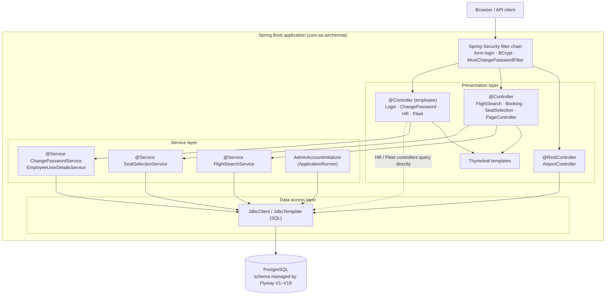
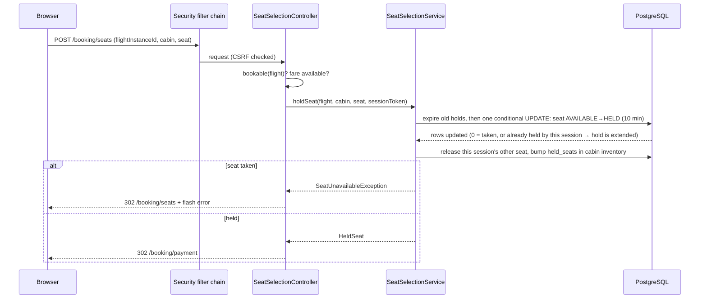
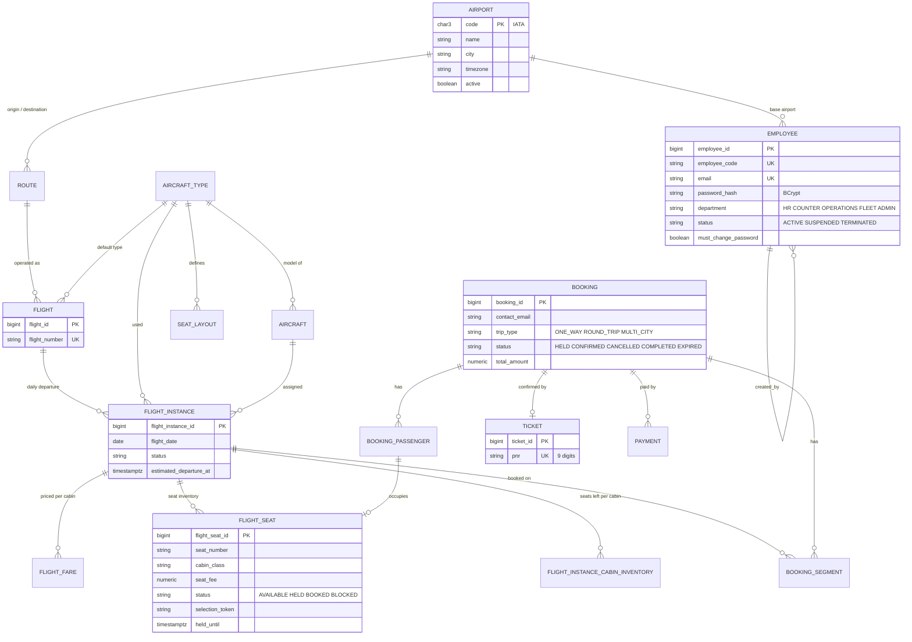

# AirChennai – Design Report

## 1. Problem statement

Domestic airlines need one system that lets **customers** find and book seats and lets **staff** run the
airline's back office. Doing this by phone or spreadsheets leads to double-booked seats, stale schedules and
no control over who may change what.

AirChennai provides:
1. A customer web application to search flights (including one-stop connections), pick a seat and pay.
2. An employee portal with role-based access (HR, Counter, Operations, Fleet, Admin) for managing staff and aircraft.

**Scope decisions:** India-only network (IST, INR); guest bookings (no customer account yet); one booking-level
ticket with a 9-digit PNR created after payment; employee roles stored as a `department` column.

**Users / actors:** Guest customer · HR employee · Fleet employee · Admin (bootstrap account).

## 2. Architecture

The application is a single Spring Boot service using a server-side-rendered MVC architecture over PostgreSQL.



| Layer | Package(s) | Responsibility |
|---|---|---|
| Presentation | `*.Controller` classes, `templates/` | Map URLs, read parameters, choose view or redirect |
| Business | `FlightSearchService`, `SeatSelectionService`, `ChangePasswordService`, `EmployeeUserDetailsService`, `AdminAccountInitializer` | Search and connection rules, seat-hold concurrency, password policy, admin bootstrap |
| Data access | `JdbcClient` / `JdbcTemplate` SQL, Flyway migrations | Persistence |
| Cross-cutting | `employee.auth.SecurityConfig`, `EmployeePageModelAdvice` (`@ControllerAdvice` adding page model attributes) | Authentication, authorisation, shared view data |

**Dependency injection:** all beans use constructor injection (e.g. `SeatSelectionController(FlightSearchService, SeatSelectionService)`); stereotypes used are `@RestController`, `@Controller`, `@Service`, `@Component`, `@Configuration`.

### 2.1 Request flow – seat hold



### 2.2 Request flow – airport autocomplete
`GET /api/airports?q=mum` → `AirportController.search` → parameterised SQL on `airport` (LIKE wildcards escaped,
max 8 rows) → rows mapped to `AirportDto` records → Jackson serialises to JSON.

## 3. Data model

PostgreSQL schema, created by Flyway migrations. Surrogate keys are `BIGINT GENERATED ALWAYS AS IDENTITY`
except `airport`, whose key is the IATA code.



**Entity description**

| Table | Purpose |
|---|---|
| `airport` | Master list of Indian airports (seeded, `active` flag, IANA time zone) |
| `route` | Directional origin → destination pair, unique per pair |
| `aircraft_type`, `seat_layout` | Aircraft model and its physical seat blueprint (row, letter, cabin, window/aisle, exit row, legroom) |
| `aircraft` | Individual airframe (registration, MSN) of a type |
| `flight` | Recurring flight number on a route |
| `flight_instance` | One departure on one date with estimated times, status, terminal, aircraft |
| `flight_fare`, `flight_instance_cabin_inventory` | Price per cabin; seats remaining per cabin |
| `flight_seat` | Per-departure seat inventory with `HELD` / `BOOKED` state and hold expiry |
| `booking`, `booking_passenger`, `booking_segment` | A reservation, its passengers and the flight legs |
| `ticket` | One per booking; holds the unique PNR after payment |
| `payment` | Payment attempts for a booking |
| `employee` | Staff account; `department` is the role; soft-deleted via `status` |

**Integrity rules enforced in the database:** `CHECK` constraints on status/enum columns, unique seat per
departure, a seat is `HELD` either by a booking or by an anonymous session token (never both), cancelled
bookings must carry `cancelled_at`, held bookings must carry `hold_expires_at`, and deferred triggers verify
seat layouts on commit.

## 4. Key design decisions

| Decision | Reason |
|---|---|
| Flyway migrations + `ddl-auto=validate` | The schema is versioned in Git; Hibernate never alters it |
| Two DB roles (migration vs application) | The running application cannot drop or alter tables |
| Seat hold stored in `flight_seat` with a session token and expiry | Guests can reserve seats without an account; expired holds free themselves |
| One-stop connections built from two flights with a 60 min – 10 h layover | Satisfies "connecting flights" without a full graph search; `MAX_CONNECTIONS = 1` |
| Employee roles as a `department` column | Simple privilege model sufficient for the project size |
| Admin bootstrap with PostgreSQL advisory lock | Safe if two instances start together; password comes from the environment, never from source |
| Soft-delete for employees (`TERMINATED`) | Keeps history and foreign keys intact |

## 5. Security design
- Form login with employee code; passwords hashed with BCrypt; account states `ACTIVE`/`SUSPENDED`/`TERMINATED` map to Spring's enabled/locked flags.
- Forced password change on first login via `MustChangePasswordFilter`; password policy (≥ 12 chars, mixed classes) checked server-side.
- Role checks: URL rule `/employee/hr/**` → `HR`, plus a defensive check inside the add-employee handler.
- CSRF protection on (framework default); all SQL uses bind parameters.

## 6. Known limitations (as of this report)
- Payment completion, PNR/ticket creation, cancellation, check-in, e-mail and frequent-flyer features are designed in the schema but not yet implemented.
- Only the HR dashboard exists; ADMIN/COUNTER/OPERATIONS/FLEET dashboard URLs return 404.
- ADMIN has no access to `/employee/hr/**`, so the first HR employee has to be inserted into the database manually, for example:
  ```sql
  -- generate the hash first, e.g. with any BCrypt tool
  INSERT INTO employee (employee_code,email,password_hash,first_name,last_name,phone_no,department,status,hired_on,must_change_password)
  VALUES ('HR001','hr@airchennai.local','<bcrypt-hash>','Hema','Rao','9000000001','HR','ACTIVE',CURRENT_DATE,TRUE);
  ```
- Data access is plain SQL through Spring JDBC; no JPA entities yet.
